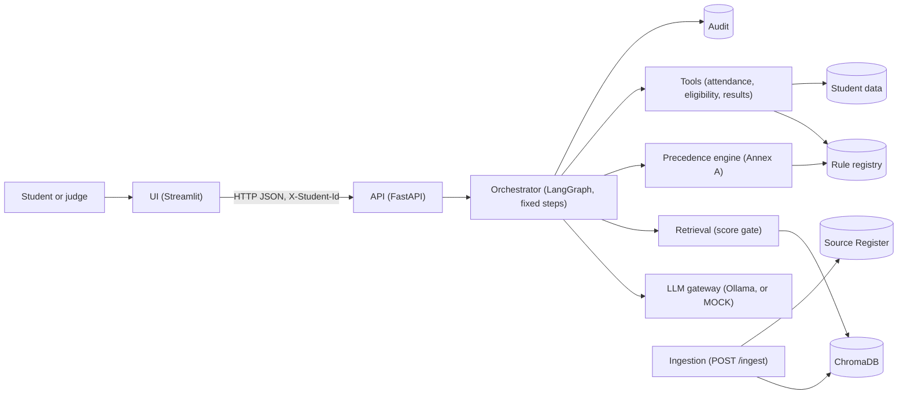

# AI-Powered University Student Services Assistant

HCLTech hackathon project. Answers student questions from authorised university documents and the student's own record, with citations, deterministic tools, and an audit trail. It says "not found" rather than guessing.

## Architecture



All tables live in one SQLite file (`data/app.sqlite3`). The architecture document (`docs/system_architecture.md`) has the full design.

## Setup

Requirements: Python 3.12, and Ollama with `qwen2.5:7b` if you want the live model.

```bash
python3 -m venv .venv
.venv/bin/python -m pip install -r requirements.txt
```

Copy `.env.example` to `.env` if you want to change settings. Never commit `.env`.

## Run

Set up the database (creates `data/app.sqlite3` and loads the Source Register and rules). It is safe to run again.

```bash
.venv/bin/python scripts/setup_db.py
```

Start the API and the UI in two terminals:

```bash
.venv/bin/uvicorn app.api.main:get_app --factory --port 8000    # with PYTHONPATH=src
.venv/bin/streamlit run src/app/ui/app.py                          # UI at http://localhost:8501
```

Or with Docker (see Docker below):

```bash
docker compose up --build
```

## Sample requests

Index the regulations first (once per running service; the text is kept on disk in `data/chroma`):

```bash
curl -s -X POST http://localhost:8000/ingest \
  -F 'metadata={"doc_id":"NITJ-UG-REG-2023","title":"Ordinances and Regulations for Undergraduate Programme 2023","issuer":"Dr B R Ambedkar NIT Jalandhar","authority_level":1,"doc_type":"regulation","version":"2023 (rev. 24 Jan 2024)","effective_from":"2024-01-24","scope_programmes":"ALL","scope_batches":"2023+","synthetic":false}' \
  -F "file=@data/documents/text/1707823221702-Revised_UG_Regulations__24_Jan_2024.txt"
```

Ask a general question (no identity needed):

```bash
curl -s -X POST http://localhost:8000/ask \
  -H "Content-Type: application/json" \
  -d '{"question": "What is the minimum attendance required to appear in the end-semester examination?"}'
```

Ask about your own record (identity from the header only). This needs student data loaded with `scripts/load_students.py`; without it the answer is "not found", as it should be.

```bash
curl -s -X POST http://localhost:8000/ask \
  -H "Content-Type: application/json" -H "X-Student-Id: S1001" \
  -d '{"question": "Am I eligible for the end-semester exam in CSDC0202?"}'
```

Add a document while the system runs (metadata follows Annex B):

```bash
curl -s -X POST http://localhost:8000/ingest \
  -F 'metadata={"doc_id":"EXAMPLE-2026","title":"Example circular","issuer":"Office","authority_level":2,"doc_type":"notice","version":"1","effective_from":"2026-01-01","scope_programmes":"ALL","scope_batches":"ALL","synthetic":true}' \
  -F "file=@data/documents/text/Instruction_to_Students_Mid-Semester_Examination_September-2026.txt"
```

Other endpoints: `GET /health`, `GET /sources`, `GET /audit/{trace_id}`.

## Tests

```bash
.venv/bin/python -m pytest                                              # all tests (MOCK mode)
.venv/bin/python -m pytest tests/integration/test_live_llm.py -s        # live Ollama, needs qwen2.5:7b running
```

## Docker

`docker-compose.yml` starts the API (port 8000) and the UI (port 8501). Ollama runs on the host, and containers reach it at `host.docker.internal:11434`. `data/` is mounted, so the database and the vector store survive restarts.

## Assumptions

- Judges' documents and test students will use the same schema (Annex B and C).
- Without a student, the scope of a document cannot be checked. Such documents are considered, and the answer states their scope.
- Attendance is compared exactly (74.96% fails a 75% threshold), even though it is displayed rounded.
- Results use internal (out of 30) and end-semester (out of 70) marks. No document states this split.
- A pass needs a total of at least 40, and at least 30% of the end-semester marks (regulations R13.1 and R13.3).

## Limitations

- **Rules are entered by hand.** A new circular is indexed and cited, but it does not change a threshold until a rule is registered (decision D1).
- **Policy precedence compares rule values or clause text.** Two versions of a clause that say the same thing in different words can be reported as a conflict.
- **Placement policy is not used.** It is a scanned PDF with no text, and OCR is out of scope.
- **Five documents have no effective date** and cannot be loaded until one is confirmed.
- **Audit and ingest endpoints have no authentication.** Acceptable for judging, not for production.
- **Live LLM quality** is checked on a small set of questions only. Evaluation (see `docs/`) is incomplete.
- **Docker** has been written but not built on this machine, because Docker is not installed.

## Documents

- `docs/case_study_analysis.md`: requirements, assumptions and uncertainties
- `docs/solution_research.md`: approaches compared
- `docs/system_architecture.md`: components, data flow, interfaces
- `docs/team_tasks.md`: task breakdown by module
- `docs/data_review.md`: university documents and data requirements
- `docs/progress.md`: what has been built, with test results
