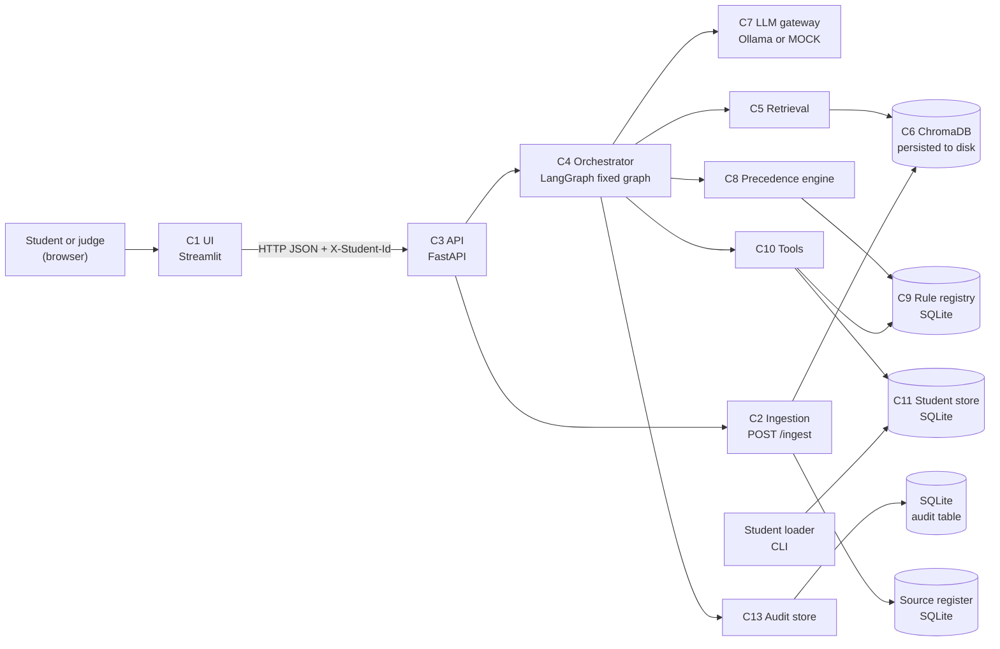
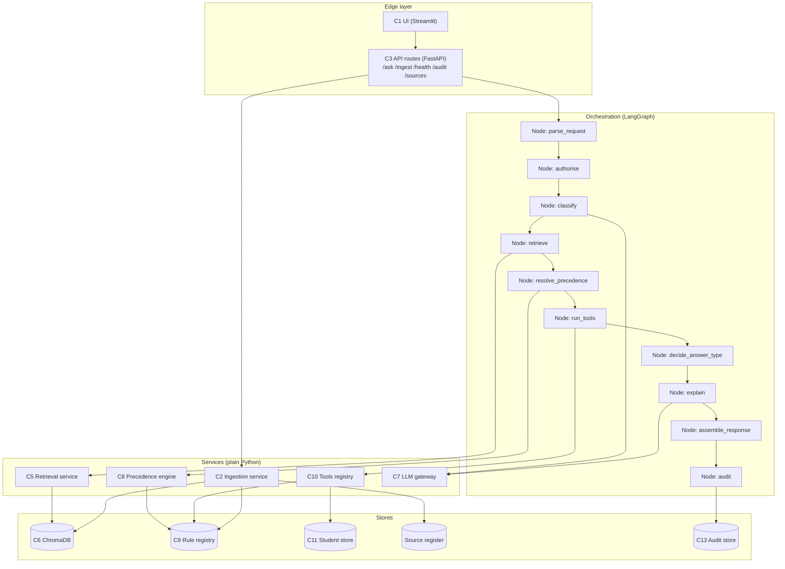

# System Architecture: AI-Powered University Student Services Assistant

**Based on:** [case_study_analysis.md](case_study_analysis.md), [solution_research.md](solution_research.md)
**Chosen approach:** Approach A from the research, a fixed workflow with the LLM at the edges only.
**Status:** Design only. No application code. Items marked **Decision** need team agreement. Items marked **Assumption** are not in the guide.

---

## 0. Design principles

1. **Deterministic core.** Precedence, eligibility, arithmetic and student lookups are plain Python. The LLM never computes them (R5).
2. **LLM at the edges.** The LLM labels the question and explains tool results. Its output is validated, and the system has a fallback when it fails.
3. **Identity from the header only.** `student_id` comes from `X-Student-Id`. Tools never accept a student ID from LLM output (R7).
4. **Fixed graph.** One LangGraph graph with known nodes. No agent loop, no multi-agent layer (research, Section 4).
5. **Every answer is auditable.** Each request writes one audit record, including failed or refused ones (R10).
6. **Small surface.** Five API endpoints, one graph, one vector store, one SQLite file.

---

## 1. Requirements-to-components mapping

Before choosing components, this table maps each requirement to the component that owns it.

| Req | What it needs | Component(s) that satisfy it |
|---|---|---|
| R1 Retrieval | Answers from ingested text | C5 Retrieval, C6 Vector store |
| R2 Citations | Doc, section, page, version, effective date on each factual answer | C5 Retrieval (chunk metadata), C4 Orchestrator (citation assembly) |
| R3 No fabrication | `not_found` with exact message; partial-evidence statements | C5 Retrieval (score gate), C4 Orchestrator (answer-type decision) |
| R4 Versions and conflicts | Annex A policy, as-of date, scope, supersession | C8 Precedence engine, C9 Rule registry, C2 Source register |
| R5 Deterministic tools | Calculations and lookups in code; thresholds from registry | C10 Tools, C9 Rule registry, C11 Student store |
| R6 Multi-step | Several tools and sources; assumptions stated | C4 Orchestrator (fixed multi-step path), C10 Tools |
| R7 Authorisation and privacy | Identity from header; refuse others; minimal logging | C3 API (header parsing), C4 Orchestrator (auth node), C10 Tools (ownership check) |
| R8 Untrusted content | Documents cannot change behaviour | C7 LLM gateway (prompt wrapping), C4 Orchestrator (output whitelist) |
| R9 Answer types | Six answer types | C4 Orchestrator (type decision), C12 Response schema |
| R10 Auditability | trace_id and full audit record | C4 Orchestrator (audit node), C13 Audit store |
| R11 Live ingestion | POST /ingest usable immediately, no restart | C2 Ingestion service, C5 Retrieval, C6 Vector store, C9 Rule registry |
| R12 Evaluation | Eval set and measured results | C14 Evaluation harness |

---

## 2. High-level architecture



**Reading the diagram:** every request passes through the API and then the orchestrator. Data stores are shown as cylinders. The LLM is one box among several, and it is only called at two points.

---

## 3. Detailed component-level architecture



**Branching inside the graph (fixed, not model-chosen):**
- `authorise` ends the run with `refused` if a personal question has no header, or names another student.
- `classify` ends with `clarification_needed` if the question is ambiguous.
- `run_tools` runs only for `personal_data` and `personal_eligibility` categories, and for multi-step questions that include them.
- `retrieve` runs for all categories except pure personal lookups. Below the score gate it returns `not_found` without calling `explain`.
- `resolve_precedence` returns `conflict_flagged` when the policy cannot decide.

---

## 4. Component responsibilities

| ID | Component | Responsibility | Owner |
|---|---|---|---|
| C1 | UI (Streamlit) | Question box, student-ID field (sent as header), answer display with citations, audit link. No business logic. | Owner TBD (Decision J5) |
| C2 | Ingestion service | Validate Source Register metadata, parse file, chunk, embed, write chunks to Chroma, record source, extract or load rules. Atomic: a document is either fully indexed or not indexed. | Owner TBD |
| C3 | API | Route handling, request and response validation (Pydantic v2), header parsing, error mapping to HTTP codes. | Owner TBD |
| C4 | Orchestrator | Runs the fixed LangGraph graph. Chooses answer type. Assembles citations, `tools_invoked` and `applied_rules`. Writes the audit record. | Owner TBD |
| C5 | Retrieval service | Embed query, search Chroma for top-k chunks, apply score gate, return chunks with metadata. | Owner TBD |
| C6 | Vector store | ChromaDB collection persisted to a local directory. Stores chunk text, embedding and metadata (doc_id, section, page, version, effective dates, scope, authority). | Owner TBD |
| C7 | LLM gateway | Single place that calls Ollama (or a cloud fallback behind a config switch, or the mock). Wraps document text as data. Validates JSON against a Pydantic schema, with one retry. | Owner TBD |
| C8 | Precedence engine | Implements Annex A steps: applicability, supersession, authority, recency, unresolved. Pure function: same inputs give same output. | Owner TBD |
| C9 | Rule registry | SQLite table with Annex C columns. Tools and precedence read thresholds from here, never from code constants. | Owner TBD |
| C10 | Tools | Named functions, for example `get_attendance`, `get_results`, `check_exam_eligibility`. Each takes `student_id` from the request context, never from LLM output. Returns values plus the `rule_id` used. | Owner TBD |
| C11 | Student store | SQLite tables `students`, `courses`, `attendance`, `results` (Annex C). Loaded by the loader script. | Owner TBD |
| C12 | Response schema | Pydantic models for the `/ask` response (Section 6.1), including `answer_type`. | Owner TBD |
| C13 | Audit store | SQLite table with one row per request, JSON columns for sources, tools, rules, model, latency and tokens. | Owner TBD |
| C14 | Evaluation harness | Runs the evaluation set against `/ask`, computes Section 7 metrics, writes a report. | Owner TBD |

**Decision (J5):** each owner is left as TBD until the team agrees the split. CLAUDE.md requires one owner per module.

---

## 5. Step-by-step data flow

### 5.1 Question path (`POST /ask`)

1. **UI** sends `question`, optional `as_of_date`, and `X-Student-Id` (if the user typed one) to `/ask`.
2. **API** validates the body with Pydantic. If `as_of_date` is missing, it uses today. Invalid input returns HTTP 422.
3. **Orchestrator: parse_request** creates a `trace_id` and starts the audit record.
4. **Orchestrator: authorise** reads the identity from the header only. If the header is absent and the question looks personal, the run ends with `refused`. Message text is never used for identity.
5. **Orchestrator: classify** calls the LLM gateway for a category label (policy, procedure, personal_data, personal_eligibility, multi_step, out_of_scope, ambiguous). The LLM output is checked against an allowed list. Failure falls back to the rule-based classifier (Section 7).
6. **Orchestrator: retrieve** calls the retrieval service with the question and `as_of_date`. The service returns top-k chunks with metadata. If the best score is below the gate threshold, the run ends with `not_found`.
7. **Orchestrator: resolve_precedence** groups chunks by topic. The precedence engine applies Annex A using the registry and source register. It returns the winning clause, any upcoming documents, and any unresolved conflict. Unresolved means `conflict_flagged`.
8. **Orchestrator: run_tools** runs the tools required by the category. The student ID comes from step 4. Each tool reads thresholds from the rule registry and returns its `rule_id`.
9. **Orchestrator: decide_answer_type** chooses one of the six types using the outcomes so far. Calculated results are `calculated`, document-only results are `retrieved_fact`, and so on.
10. **Orchestrator: explain** calls the LLM gateway with the question, the retrieved chunks wrapped as data, and the tool outputs. The LLM writes the explanation. It may not add numbers that are not in the tool output; this is checked (Section 7).
11. **Orchestrator: assemble_response** builds the Section 6.1 response: `answer`, `citations`, `tools_invoked`, `applied_rules`, `conflicts_detected`, `explanation`, `as_of_date`.
12. **Orchestrator: audit** writes the audit record to C13 (Annex D fields), including refused and not-found runs.
13. **API** returns the response. The UI shows the answer and the trace_id.

### 5.2 Ingestion path (`POST /ingest`)

1. **API** receives the file and a metadata JSON.
2. **Ingestion** validates metadata against Annex B: `doc_id` unique, `authority_level` 1–5, `effective_from` format, `scope_programmes`, and `synthetic`. Invalid metadata returns HTTP 422 and nothing is written.
3. **Ingestion** parses the file. Text PDFs are supported. Scanned PDFs are out of scope (OCR not required).
4. **Ingestion** splits text into chunks that keep section and page labels. Chunk size stays under the embedding model's 256-token truncation (research, S5).
5. **Ingestion** embeds the chunks and writes them to Chroma with metadata, in one transaction-like step (write to a staging collection, then swap or delete on failure).
6. **Ingestion** writes the Source Register row.
7. **Ingestion** loads rules for this document. This step depends on Decision J1 (Section 9).
8. **Response** returns `doc_id`, `chunks_indexed`, and `status`.

The retrieval service reads Chroma on every query, so the document is used immediately. No restart is needed (R11).

### 5.3 Student loader path (CLI)

1. Read CSVs from a directory (`test_students/`).
2. Validate against the Annex C schema and logical rules (attended ≤ held, total = internal + external, result consistent with marks).
3. Reject the whole file on any violation and print the violations. This keeps partial data out of the store.
4. Insert rows in one transaction.

---

## 6. APIs and interfaces

### 6.1 HTTP endpoints (fixed by the guide)

| Method | Path | Request | Response | Errors |
|---|---|---|---|---|
| POST | `/ask` | Header `X-Student-Id` (optional). Body: `question` (string), `as_of_date` (YYYY-MM-DD, optional) | Response JSON (Section 6.1 of guide) | 422 invalid body; 500 internal (still writes audit if possible) |
| POST | `/ingest` | Multipart: `file`, `metadata` (JSON string, Annex B fields) | `doc_id`, `chunks_indexed`, `status` | 422 invalid metadata or unsupported file; 409 duplicate `doc_id`; 500 with rollback |
| GET | `/health` | none | `api`, `vector_store`, `sqlite`, `llm` status, each `ok` or `error` | 503 if any required store is down |
| GET | `/audit/{trace_id}` | path | full audit record (Annex D) | 404 unknown trace |
| GET | `/sources` | none | list of Source Register rows | none |

### 6.2 Internal interfaces (Python, Pydantic models)

These are the contracts between components. Each module can be built and tested against them.

```python
# Shared models (owner: TBD, Decision J5)
class AskRequest:          question: str; as_of_date: date | None; student_id: str | None
class Chunk:               doc_id: str; section: str; page: int | None; version: str
                           effective_from: date; effective_to: date | None
                           authority_level: int; scope_programmes: list[str]
                           scope_batches: str; text: str; score: float
class Citation:            doc_id: str; title: str; section: str; page: int | None
                           version: str; effective_from: date
class ToolResult:          tool: str; input: dict; output: dict; rule_id: str | None; status: str; ms: int
class PrecedenceDecision:  winner: Citation | None; superseded: list[str]
                           upcoming: list[Citation]; conflict: bool; reason: str

# C5 Retrieval
def retrieve(question: str, as_of: date, top_k: int) -> list[Chunk]

# C8 Precedence
def resolve(chunks: list[Chunk], student: StudentContext | None, as_of: date,
            registry: RuleRegistry) -> PrecedenceDecision

# C10 Tools (student_id is injected by the orchestrator, never from LLM output)
def get_attendance(student_id: str, course_code: str) -> ToolResult
def check_exam_eligibility(student_id: str, course_code: str, as_of: date) -> ToolResult

# C7 LLM gateway
def classify(question: str) -> CategoryLabel             # validated enum
def explain(question: str, chunks: list[Chunk], tools: list[ToolResult]) -> str

# C2 Ingestion
def ingest(file: bytes, metadata: SourceMetadata) -> IngestResult

# C13 Audit
def write_audit(record: AuditRecord) -> None
def read_audit(trace_id: str) -> AuditRecord | None
```

---

## 7. Error handling and fallback mechanisms

| Failure | Detection | Behaviour | Answer type | Audit flag |
|---|---|---|---|---|
| Missing `X-Student-Id` on personal question | Authorise node | Stop before any tool runs | `refused` | `auth: missing` |
| `X-Student-Id` names another student | Tool ownership check (student_id from header only) | Refuse; no data returned | `refused` | `auth: cross_student` |
| Ambiguous question | Classifier label `ambiguous` | Ask a clarifying question | `clarification_needed` | `category: ambiguous` |
| No chunk above score gate | Retrieval score | Return the exact not-found message | `not_found` | `gate: below_threshold` |
| Chunks found but partial | Precedence engine finds gaps | State what is known and not known | `retrieved_fact` with partial statement | `partial: true` |
| Unresolved conflict | Precedence step 5 | Cite both documents; advise contacting office | `conflict_flagged` | `conflict: unresolved` |
| LLM returns invalid JSON (classifier) | Pydantic validation | Retry once; then rule-based classifier | unchanged | `llm_fallback: classifier` |
| LLM unavailable (Ollama down) | Connection error or timeout | Use template explanation built from tool output and citations; do not invent text | unchanged | `llm_fallback: template` |
| LLM adds a number not in tool output | Number check: each number in the explanation must appear in tool output or citations | Replace explanation with template | unchanged | `llm_fallback: number_mismatch` |
| Tool raises an error (e.g., student not in DB) | Tool status | Return a clear message; do not guess | `not_found` for that part | `tool_error: <name>` |
| Document has bad metadata at ingest | Metadata validation | Reject; nothing written | HTTP 422 | none |
| Chroma write fails mid-ingest | Exception during write | Remove partial chunks for `doc_id`; keep no Source Register row | HTTP 500 | none |
| Duplicate `doc_id` | Source Register lookup | Reject | HTTP 409 | none |
| Student loader finds a violation | Validation step | Reject the whole file | CLI error | none |
| Audit write fails | Exception on write | Log error; still return the answer; mark response with `audit_error` header | unchanged | n/a |

**Principle:** when a component fails, the system prefers to return a less informative answer over a guessed one. It never returns a number that no tool produced.

---

## 8. Security and data privacy

- **Identity.** Only the `X-Student-Id` header identifies the student. Message text is never parsed for IDs. Tools receive `student_id` from the orchestrator, not from the model.
- **Tool whitelist.** The orchestrator may call only the named tools in C10. The LLM chooses a category label, not a free-form tool name.
- **Prompt injection.** Retrieved text is placed in a clearly marked data block, with the instruction that it is not to be followed. The LLM output is validated against allowed values. Document text cannot add tools, change identity or change thresholds (R8).
- **Thresholds come only from the registry.** A document can propose a rule (depending on Decision J1), but the registry entry must carry a `source_doc_id` and `source_section`.
- **Minimal logging.** Logs record `trace_id`, category, answer type and timings. They do not record question text or personal values. The audit record keeps `student_id` because Annex D requires it; see the limitation below.
- **Secrets.** API keys and any cloud LLM key come from environment variables loaded from a `.env` file. `.env` is listed in `.gitignore`. A `.env.example` lists variable names with no values. Nothing is hard-coded (CLAUDE.md rule 12).
- **Synthetic data only.** Student and document data are synthetic or public. Reserved IDs S9000–S9999 and JDG course codes are not used (guide rule).
- **Upload safety.** Accept only PDF or plain-text uploads. Check the size limit. Store files under generated names, never under the uploaded name, to block path traversal.
- **Ingest endpoint.** No authentication in the MVP. Judges need open access during live testing. This is a stated limitation (Section 10).
- **Local-first LLM.** Ollama runs locally, so student questions do not leave the machine by default. A cloud fallback must be disclosed in the README (guide).

---

## 9. Testing points at each stage

| Stage | Test type | What is checked | Tool |
|---|---|---|---|
| Ingestion metadata | Unit | Annex B validation; rejects bad fields | pytest |
| Ingestion parse and chunk | Unit | Section and page labels kept; chunk length under limit | pytest |
| Ingestion atomicity | Integration | Chroma failure leaves no partial chunks | pytest with fault injection |
| Retrieval | Unit + eval | Known query returns expected doc in top-k (hit rate) | pytest, eval harness |
| Score gate | Unit + eval | Unanswerable questions return `not_found` | eval harness |
| Precedence engine | Unit (fixtures) | Each Annex A step; worked example (80% / 75% / 65%); future-dated and out-of-scope documents | pytest |
| Rule registry | Unit | Every threshold has `source_doc_id` and `source_section` | pytest |
| Tools | Unit | Hand-computed attendance %, eligibility outcomes, boundary cases (exactly 75%, one below) | pytest |
| Tool ownership | Unit | Request with student A cannot see student B | pytest |
| LLM gateway | Unit (mock) | JSON validation; retry; fallback; prompt wrapping | pytest with mock Ollama |
| Number check | Unit | Explanation with an extra number is replaced | pytest |
| Orchestrator graph | Integration | Each branch: refused, clarification, not_found, conflict, normal | pytest with `MOCK_LLM=true` |
| API contract | Contract | Response matches Section 6.1 schema; 422 and 404 paths | pytest + FastAPI test client |
| Audit | Integration | Every request, including refused, writes one audit row | pytest |
| Live ingest | End-to-end | New document answers a question with no restart | manual script + eval |
| Full pipeline | End-to-end | Demo scenarios: cited policy, eligibility, not_found, conflict | eval harness |
| Docker | Smoke | `docker compose up`; `/health` returns ok | shell script |
| Evaluation | Measured | Section 7 metrics; p50/p95 latency; LLM calls and tokens | eval harness |

**Test data.** The synthetic student generator includes the edge cases from the analysis (Section H): attendance exactly at threshold, one below, marks just under pass, absent, detained, multiple backlogs.

---

## 10. Potential failure points and how we detect them

| # | Failure point | Likelihood (our estimate) | Detection | Mitigation |
|---|---|---|---|---|
| F1 | Rule registry not populated for judges' documents (Decision J1) | High | `/sources` shows documents with zero rules; eval case fails | Decide J1 early; manual rule entry path for the demo |
| F2 | Local 8B model returns bad JSON or wrong category | High | Validation failure count in audit (`llm_fallback`) | Retry, rule-based fallback, Improvement 1 comparison |
| F3 | LLM invents a number | Medium | Number check; eval citation accuracy | Template fallback; tool-only numbers |
| F4 | Retrieval misses the right chunk | Medium | Retrieval hit rate in eval | Chunk size tuning; top-k tuning |
| F5 | Score gate too strict (false `not_found`) | Medium | Abstention accuracy on answerable set | Threshold sweep (Improvement 2) |
| F6 | Score gate too loose (fabrication) | Medium | Abstention accuracy on unanswerable set | Same sweep; LLM instruction as second check |
| F7 | Chunk exceeds embedding model limit and loses text | Medium | Ingest warning when token count exceeds 256 | Chunker enforces limit |
| F8 | Judge uploads a PDF with no text layer (scanned) | Medium | Ingest returns 422 "no extractable text" | Explain limitation; OCR is out of scope |
| F9 | Wrong ordering of effective dates or time zone for `as_of_date` | Low | Precedence fixture tests | Store dates as ISO strings; compare as dates |
| F10 | Slow answers on a laptop (p95 latency) | Medium | Latency in audit; eval report | Smaller model; fewer LLM calls; measure first |
| F11 | Docker cannot reach Ollama on host | Medium | `/health` `llm: error` | Document `host.docker.internal` setup; health check |
| F12 | Student data leak in logs | Low | Log review test; grep for question text | Minimal logging rule; test |
| F13 | Team members cannot explain their module | Medium | Q&A rehearsal; owner sign-off per module | Owner per module (Decision J5); design docs |
| F14 | Git history shows one author only | Medium | `git log` before code freeze | Each member commits under own identity |
| F15 | Ingest endpoint abused during judging | Low | Ingest rate in logs | Documented limitation; size limit |

---

## 11. Technology selection and why

| Component | Technology | Why | Source or basis |
|---|---|---|---|
| C1 UI | Streamlit | Minimal code for a simple form and display; allowed by the guide | Guide Section 5 |
| C3 API | FastAPI, Uvicorn, Pydantic v2 | Mandatory; Pydantic gives validation for every contract | Guide Section 5 |
| C4 Orchestrator | LangGraph | Mandatory; fixed graph with conditional edges and state; used as a workflow, not an agent loop | Guide Section 5; Anthropic workflows definition (research S1, S2) |
| C5 Retrieval | sentence-transformers `all-MiniLM-L6-v2` | Small (384 dimensions), fast on a laptop, allowed by the guide. Truncates at 256 tokens, so chunks stay short | Research S5 |
| C6 Vector store | ChromaDB, persistent client | Mandatory; local disk, no server needed | Guide Section 5. Persistence behaviour not yet verified (research S11) |
| C7 LLM | Ollama with `llama3.1:8b` or `qwen2.5:7b-instruct` | Mandatory local LLM; both are named in the guide. Structured output via `format` with a JSON schema | Guide Section 5; Ollama blog, 6 Dec 2024 (research S3); API docs (research S4) |
| C7 mock | `MOCK_LLM=true` | Tests run without the model | Guide Section 5.1 |
| C8 Precedence | Plain Python | Pure function is easy to test; policy is ordered steps | Analysis R4; Annex A |
| C9 Rule registry | SQLite | Mandatory; one file; schema from Annex C | Guide Section 5 and Annex C |
| C10 Tools | Plain Python functions | Deterministic; testable; explainable | Analysis R5 |
| C11 Student store | SQLite | Mandatory; Annex C schema | Guide Section 5 |
| C13 Audit store | SQLite table | Same file as other data; queryable by `trace_id`; survives restarts | Decision D2 (Section 13) |
| Ingestion parse | `pypdf` (to be confirmed) | Text extraction from text-layer PDFs; no OCR needed | Assumption. Not yet evaluated |
| Packaging | Docker, docker compose | Mandatory; services for API, UI; Ollama on host | Guide Section 5 and 8 |
| Config | Environment variables, `.env` | Keeps keys out of code | CLAUDE.md rule 12 |

**Not chosen:** a multi-agent layer, free-form text-to-SQL, and an autonomous tool-calling loop. Reasons are in the research comparison (Section 3 of solution_research.md).

---

## 12. Proposed project layout (for planning only)

```
hcltech-hackathon/
  CLAUDE.md
  docs/                      # analysis, research, architecture, progress
  src/
    app/
      api/                   # C3 FastAPI routes, C12 schemas
      orchestrator/          # C4 LangGraph graph and nodes
      retrieval/             # C5, C6
      ingestion/             # C2
      precedence/            # C8
      tools/                 # C10
      llm/                   # C7
      storage/               # C9, C11, C13 (SQLite access)
      ui/                    # C1 Streamlit
  scripts/
    load_students.py         # student loader
    validate_students.py     # validation script
    generate_students/       # LLM generator and prompts (Annex E)
  data/
    documents/               # official documents (Source Register applies)
    students/                # synthetic CSVs
  tests/
    unit/
    integration/
    eval/                    # evaluation set and harness
  docker-compose.yml
  .env.example
  README.md
```

**Decisions for this layout:**
- Module boundaries follow the components in Section 4, so each owner works in one folder.
- `data/` is where generated and downloaded files live. Real personal data is never placed there.

---

## 13. Decisions and open items

| # | Decision | Proposed answer | Status |
|---|---|---|---|
| D1 | Rule registry population (guide question J1) | MVP: rules are entered through a registry CSV or admin entry, each with `source_doc_id` and `source_section`. Ingest stores the document but creates no rules automatically. Automatic LLM extraction is a stretch goal, only if time allows and with human review. | **Needs team decision.** Most important open item. |
| D2 | Audit persistence | Store in SQLite so it survives restarts | Proposed |
| D3 | PDF parsing library | `pypdf`, after a check on the team's real documents | To confirm |
| D4 | Chunk size and overlap | Keep chunks under the 256-token limit; tune with eval | To measure |
| D5 | Module owners | One owner per component (Section 4) | Needs team decision (J5) |
| D6 | Cloud fallback | Not used in the demo unless local model fails; disclosed in README | Needs team decision (J4) |

---

## 14. Limitations of this design

- **Ingest and admin endpoints are open.** No auth. Acceptable for a hackathon judging setup, not for production.
- **Rules are not extracted automatically in the MVP** (D1). A judge who uploads a circular that changes a threshold will see no change in answers until a rule is added. This is the main risk to R11 and R4.
- **Audit records contain `student_id`.** Annex D requires it. Access control on `/audit` is not in the MVP.
- **Single-process design.** No queueing; ingestion blocks the API while it runs. Acceptable for the demo size.
- **Retrieval quality depends on chunking.** Tables in fee and grading documents may split badly. This is measured in evaluation, not solved in design.
- **Model quality is unverified** until tested on the team's machines (research open items).
- **Not validated against real university processes.** Thresholds and rules come from documents we choose, which may differ from the university's actual practice.
